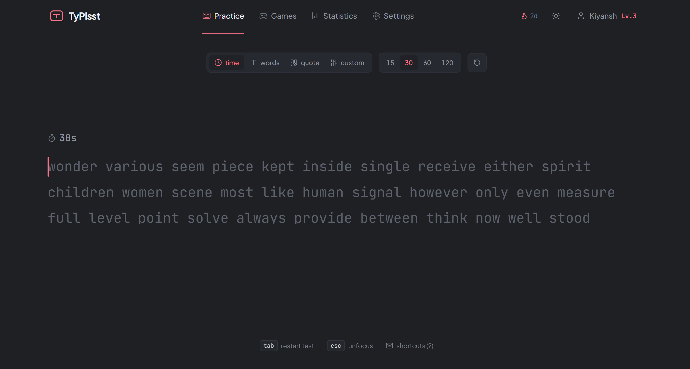

# TyPisst

<p align="center">
  <strong>A minimalist, high-precision typing platform designed for rhythm, speed, and games.</strong>
</p>


---

<!-- UI PREVIEW -->
<p align="center">
  
</p>

---

## Overview

**TyPisst** is an intentional, distraction-free typing environment built for writers, developers, and speed-typing enthusiasts. By stripping away visual noise and centering the typing canvas in a spacious, widescreen layout, TyPisst lets you dial into your natural keystroke cadence.

---

## Key Highlights

### ⚡ Focus-First Typing Canvas
* **Spacious Widescreen Layout**: Expansive horizontal margins calibrated for natural reading speeds and multi-word forward sightlines.
* **Fluid Smooth Caret**: Micro-animated caret tracking that glides effortlessly across words in real time.
* **Mechanical Sound Feedback**: Subtle, satisfying audio cues with every key strike to reinforce steady rhythm.
* **Instant Keyboard Control**: Restart tests immediately with `Tab`, dismiss overlays with `Esc`, and resume typing from anywhere on the screen without clicking.

### 🎯 Versatile Practice Modes
| Mode | Available Options | Description |
| :--- | :--- | :--- |
| **Time** | 15s · 30s · 60s · 120s | Classic timed sprint against the clock to measure peak output. |
| **Words** | 10 · 25 · 50 · 100 words | Fixed word queues for consistency and pacing practice. |
| **Quote** | Short · Medium · Long · All | Curated literary and historical excerpts with source attribution. |
| **Zen** | Infinite flow | Freeform typing session without timers, errors, or pressure. |
| **Custom** | Any custom passage | Paste documentation, code snippets, or practice text of your choice. |

---

## 🎮 Arcade & Skill Challenges

Step beyond standard practice runs with dedicated typing mini-games designed to train specific dexterity reflexes:

* **Falling Words**: High-tempo arcade defense where words descend toward the deadline. Clear them before they cross your defensive threshold.
* **Word Sprint**: Queue-clearing velocity challenge designed to train burst speed and word chunking.
* **Survival Mode**: High-stakes endurance mode featuring 3 lives across 5 escalating difficulty tiers.
* **Accuracy Challenge**: Surgical precision training where mistakes deduct rank points, grading your discipline from Rank D to Rank S.
* **Daily Challenge**: A synchronized daily passage reset every 24 hours. Compete with yourself to log the best daily score.

---

## 📊 Comprehensive Analytics

Track your improvement over time with detailed telemetry recorded locally after every single test:

* **Instant Diagnostics**: Immediate breakdown of WPM, Raw WPM, Character Accuracy, and Consistency percentage.
* **WPM Timeline Velocity Chart**: Interactive performance curve showing speed surges and hesitations second-by-second.
* **Personal Bests Matrix**: Automatic high-score logging broken down by mode, duration, and test parameters.
* **Activity History**: Complete searchable timeline of recent runs to spot long-term speed plateaus and breakthroughs.

---

## 🏆 Progression & Gamification

* **Daily Streaks**: Build long-term consistency with daily streak counters that reward disciplined practice.
* **XP & Level Scaling**: Earn experience points weighted by test duration, accuracy, and difficulty to advance typist ranks.
* **Achievement Badges**: Unlock milestones celebrating precision, endurance, game mastery, and breakthrough speeds.

---

## ⌨️ Shortcuts Reference

| Shortcut | Action |
| :--- | :--- |
| <kbd>Tab</kbd> | Quick restart current test / new session |
| <kbd>Esc</kbd> | Unfocus input / Finish Zen session |
| <kbd>Ctrl</kbd> + <kbd>Backspace</kbd> | Delete entire preceding word |
| <kbd>Any Key</kbd> | Instant auto-focus typing canvas |

---

## Quick Start

### Installation

Clone the repository and install dependencies:

```bash
git clone https://github.com/aashis719/typisst.git
cd typisst
npm install
```

### Development

Start the local development server:

```bash
npm run dev
```

Visit `http://localhost:3000` in your browser.

### Build

Compile for production deployment:

```bash
npm run build
```

---

<p align="center">
  Made for typists who care about rhythm, precision, and craft.
</p>
